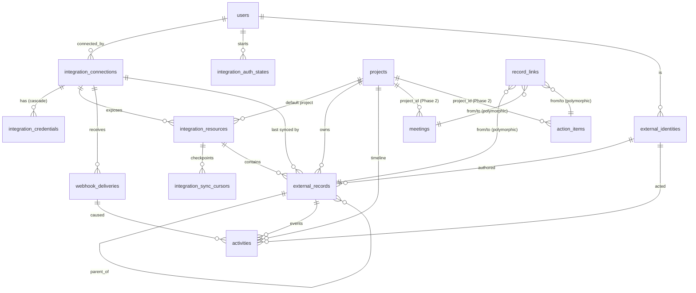

# Phase 3A — Integration Framework & Core Data Architecture (implementation plan)

Status: **IMPLEMENTED (2026-10-30)**, steps 1–10 committed on `phase-2-work-management` (`a6c63c4` … step 10). Operations guide: `docs/runbooks/integrations.md`.

**Deviations from this plan, as built:**
- `integration_sync_cursors.cursor` is named `cursor_state` (`CURSOR` is a reserved word in MySQL).
- `activities.external_record_id` has a plain foreign key, with no `ON DELETE` action. MySQL forbids referential actions on columns used in a CHECK, and records are never deleted.
- Duplicate detection uses `ER_DUP_ENTRY`, not `affectedRows`. mysql2 sets `FOUND_ROWS`, so a no-op `ON DUPLICATE KEY` reports 1, the same as an insert.
- Configuration was added in the step that uses it, not all in step 1.
- "Refresh resources" runs in the request, not as an `integration.connection` job. There is no periodic provider health-check job; health comes from sync and webhook outcomes.
- Two endpoints were added in step 8, which the data model needed: `PUT /external-records/:id/project` (a manual move, which locks the record) and identity matching (`GET/PATCH /integrations/identities`).
- `handleWebhook()` returns `resourceRef` with its envelopes. Envelopes are only written for an enabled resource, so webhooks cannot bypass opt-in sync.
- Maintenance runs every 6 hours under a single dedupe key, not once a day per date.
- **Changed in Phase 3B:**
  - Streams of a resource now run in the connector's order (parents first) instead of round-robin, so a comment never arrives before its issue in a backfill.
  - Finished streams are marked per run (`007_sync_cursor_completion.sql`, `completed_at`), so a run spanning several jobs doesn't re-check them.
  - Automatic identity matching is limited to a provider-verified email. Alias/name matching was removed as unsafe.
Inputs: `WORKAGENT_CURRENT_STATE.md`, `WORKAGENT_MASTER_ROADMAP.md`, `WORKAGENT_NEXT_STEPS.md`, and a source audit of `backend/src` on 2026-10-30.
Fixed decisions: GitHub App auth · existing Cloudflare Tunnel for dev webhooks · an encryption key per deployment, held in an environment variable · MySQL 8.4 · Express 5 · separate worker · MySQL job queue · no new npm dependencies.

---

## 1. Findings from the existing code

| Area | What exists (verified in source) | What it means for 3A |
|---|---|---|
| Layering | `routes/` (zod + guards) → `controllers/` → `services/` → `repositories/` (raw SQL via `mysql2`). Mappers such as `toPublicUser` whitelist the fields a response may contain. | Copy it unchanged. Credentials get their own repository, and only the vault calls it. |
| Provider isolation | Each external system has exactly one client module (`services/vexa/client.js`, `services/ai/claudeClient.js`, `services/email/*Provider.js`). `VexaError` carries `{kind, status, retryable, retryAfterMs, publicMessage}`, and the HTTP status → error-kind mapping lives in the client. The client is a plain object, so tests swap in a fake `fetch`. | This becomes the generic `ProviderError` and the connector-side HTTP helper. |
| Job queue (`jobs/queue.js`) | `FOR UPDATE SKIP LOCKED` claim ordered by `run_at, id`. 30 s heartbeat lease. `fail()` checks lease ownership. Backoff with ±20 % jitter, capped at 30 min. Terminal states `failed`/`dead`. `dedupe_key` is UNIQUE only while the job is active (cleared on finish). `RescheduleJob(delayMs)` gives back the claimed attempt. `claimNext(workerId, types)` already accepts a type filter. `payload` is JSON and visible to anyone who can read the table. | Usable as-is for sync and webhook jobs. Payloads carry **IDs only**: no secrets, no webhook bodies. |
| Worker (`worker.js`) | One **serial** loop: one job at a time, stale-lease recovery every 60 s, no scheduler or cron, and `handlers` registered statically. | **Constraint:** a long GitHub backfill would block `email.send` and `ai.extract`. 3A must (a) cap the work each job does and reschedule, (b) let a worker run only some job types (`WORKER_JOB_TYPES`), and (c) add a scheduler tick to the loop. |
| Audit (`services/audit.js`) | `audit_logs(actor_user_id, action VARCHAR(64), entity_type VARCHAR(32), entity_id BIGINT, before_json, after_json, ip)`. `recordAudit(conn, …)` writes inside the caller's transaction; `audit()` is best-effort. | Use it for admin actions (connect, disconnect, enable, mapping, replay). It is **not** the activity timeline. |
| Auth / authz | Revocable sessions; `requireAuth`, `requireRole`; `services/permissions.js` (`canViewProject`, `canManageProject`). Admin-only routers are mounted in `routes/index.js`. | Integration management is admin-only. Reading synced records reuses project visibility. |
| HTTP app (`app.js`) | A global `express.json({limit:'100kb'})`, skipped for one regex path (the transcript upload). The request logger writes `req.originalUrl`, **query string included**. `trust proxy` is unset. No CORS. | The webhook route needs the **raw body** (to verify the signature) and a larger limit, using the same skip-path pattern. Callback secrets must never travel in query strings to the API. |
| Logger (`utils/logger.js`) | JSON lines, **no redaction**. | Add field-name redaction before any credential code lands. |
| DB | `pool` uses `timezone:'Z'`; `withTransaction`. The migration runner is forward-only, uses SHA-256 checksums, applies one file per `multipleStatements` query, and states that MySQL DDL auto-commits. 4 migrations; the newest is `004_work_management.sql`. | 3A adds `005` and `006`. **Both only create new tables; no existing table is altered.** |
| "Tasks" | There is no tasks table. Tasks are `action_items` (`review_status` + `task_status` + `project_id`). | Internal link targets are `meeting`, `action_item`, `project`, `user`. |
| Project propagation | When a meeting's project changes, the items that followed it move with it; items an admin moved by hand stay put (Phase 2). | The same rule applies to resource → record project defaulting. |
| Re-extraction | Replaces pending AI `action_items` (deletes their rows). | Any future `record_links` that point at those items must be deleted in the same transaction (polymorphic links have no FK). |

---

## 2. Challenged assumptions

1. **"Securely store integration credentials" is a small job for GitHub.** A GitHub App's long-lived secrets (App ID, private key PEM, webhook secret) are *per-deployment configuration*, so under the env-var decision they belong in env. The only per-connection credential is the installation access token, which expires after 1 h and can be minted again at any time. The vault is still built in 3A, because Jira, Microsoft Graph and Figma all need encrypted OAuth refresh tokens. In 3B, GitHub uses it to cache installation tokens, so both the API and worker processes share them and a restart doesn't lose them. Keep the vault small.
2. **External records must not be unique per connection.** If an admin disconnects and re-installs the GitHub App, they get a new `installation_id` and therefore a new connection. Records keyed by `(connection_id, …)` would then be duplicated. The key is instead `(provider, source_instance, record_type, external_id)`, where `source_instance` is `github.com`, a GHES host, or a Jira cloud ID.
3. **Deduplicating webhooks by delivery ID breaks manual redelivery.** GitHub redelivers with the **same** `X-GitHub-Delivery` GUID. Rule: a duplicate of a `processed`/`received`/`processing` delivery is acknowledged and dropped. A duplicate of a `failed` delivery is queued again.
4. **Webhooks are not ordered and are not the source of truth.** They speed things up. Correctness comes from (a) stale-write protection on `source_updated_at` and (b) periodic incremental sync, which acts as reconciliation (this mirrors the Vexa design, where polling is primary).
5. **A serial worker cannot "run connectors simultaneously".** Isolation comes from bounded jobs plus dedicated worker processes (`WORKER_JOB_TYPES=integration.sync,integration.webhook`), not from threads. In-process concurrency is deferred until it is measured to be needed.
6. **Do not mirror internal entities into `external_records`.** Meetings and action items stay in their own tables. `record_links` refers to them polymorphically. Vexa transcripts are not external records.
7. **Projects are not stored in `record_links`.** Each record has exactly one owning project, held in the `project_id` column (the same pattern as meetings and action items). Two sources of truth would drift.
8. **`activities` ≠ `audit_logs`.** The audit log answers "who changed what in WorkAgent" (accountability). Activities answer "what happened in the work" (the timeline and correlation input). Both stay.
9. **The tunnel must expose only the webhook path.** Exposing the whole dev API publicly is an avoidable risk. The cloudflared ingress should route only `^/api/v1/webhooks/` to `:4000` and answer 404 for everything else. IP-based rate limiting on webhooks is pointless behind the tunnel (every request arrives from `127.0.0.1`), so protection comes from the signature plus a body-size cap.
10. **"Enable/disable integrations" happens at two levels.** A *provider* is available when its env configuration is present (code registry + `configProblem()`). A *connection* has an admin `is_enabled` flag in the DB. There is no providers table.
11. **Data visibility is a product decision, not a technical one.** If a private repo is mapped to a project, every project member sees PR and issue titles, even members without GitHub access. Proposed default: only admins map resources to projects, and the UI warns. This needs your confirmation (§11).

---

## 3. Proposed architecture

```
                       admin browser (React)
                             │  /api/v1 (session cookie)
                             ▼
┌──────────────────────── Express API ───────────────────────────────────┐
│ routes/integrations.js  (admin)   routes/webhooks.js (public, raw body) │
│        │                                   │ verify signature (provider)│
│        ▼                                   ▼                            │
│ services/integrations/                                                  │
│   registry.js ── providers/<id>/index.js (connector modules)            │
│   connections.js  (lifecycle, status, audit)                            │
│   vault.js        (AES-256-GCM, keyring)  ── repositories/credentials   │
│   webhooks.js     (store delivery + enqueue in one transaction)         │
│   ingest.js       (normalized envelopes → records/activities/links)     │
│   scheduler.js    (due resources → integration.sync jobs)               │
└──────────────┬───────────────────────────────────────────┬──────────────┘
               │ jobs table (IDs only)                     │
               ▼                                           ▼
┌──────────────────────── Worker(s) ─────────────────────────────────────┐
│ handlers: integration.sync · integration.webhook · integration.maintenance│
│   ctx = { connection, http (auth, rate-limit capture), vault, logger, budget }│
│   provider returns normalized envelopes → ingest.js writes them         │
│ loop: recover (60 s) · scheduler tick (60 s) · processNext(types filter)│
└─────────────────────────────────────────────────────────────────────────┘
                     MySQL: 005 integration tables · 006 work-record tables
```

Principles:
- **Connectors never touch the database.** They call the provider API and return *normalized envelopes* (records, activities, identities, links, an updated cursor, rate-limit info). The framework owns every write, cursor, status change, audit row and retry decision. This keeps connectors isolated, lets them be tested against fixtures, and means the next connector adds a folder rather than changing the core.
- **One error taxonomy.** Connectors throw `ProviderError(kind)`. The framework maps each kind to a job outcome and to connection health (§7.4).
- **Jobs carry IDs only:** `{resourceId}`, `{deliveryId}`, `{connectionId, op}`.

---

## 4. Database design

Two additive migrations. Every table is `InnoDB utf8mb4_0900_ai_ci`. Timestamps are UTC (pool `timezone:'Z'`). Times that come from source systems use `DATETIME(3)`. No tenant columns. No `ALTER` on any existing table.

### 4.1 Migration `005_integrations.sql` — framework tables

#### `integration_connections` — one row per authorized account or installation
| Column | Type | Notes |
|---|---|---|
| id | BIGINT UNSIGNED PK AI | |
| provider | VARCHAR(32) NOT NULL | registry id, e.g. `github` |
| source_instance | VARCHAR(191) NOT NULL | `github.com`, a GHES host, a Jira cloud ID |
| external_account_id | VARCHAR(191) NOT NULL | GitHub `installation_id` |
| account_login | VARCHAR(191) NULL | org/user login |
| account_type | VARCHAR(32) NULL | `Organization`/`User` |
| display_name | VARCHAR(200) NOT NULL | |
| status | ENUM('pending','active','suspended','error','disconnected') NOT NULL DEFAULT 'pending' | provider-side state |
| is_enabled | BOOLEAN NOT NULL DEFAULT TRUE | admin intent (pause) |
| settings | JSON NULL | non-secret: permissions, events, repository_selection |
| health | ENUM('unknown','healthy','degraded','failing') NOT NULL DEFAULT 'unknown' | |
| consecutive_failures | INT NOT NULL DEFAULT 0 | |
| last_error_code | VARCHAR(64) NULL | `ProviderError.kind` |
| last_error_message | VARCHAR(500) NULL | public, sanitized |
| rate_limit_remaining | INT NULL | |
| paused_until | DATETIME NULL | rate-limit pause, shared across workers |
| last_sync_started_at / last_sync_succeeded_at | DATETIME NULL | |
| last_webhook_at | DATETIME NULL | |
| connected_by, disconnected_by | BIGINT UNSIGNED NULL FK→users(id) ON DELETE SET NULL | |
| connected_at, disconnected_at | DATETIME NULL | |
| created_at, updated_at | DATETIME | standard |

PK `id`. **UNIQUE** `uq_conn_account (provider, source_instance, external_account_id)`. KEY `idx_conn_status (status, is_enabled)`. Rows are never deleted. Disconnecting keeps the row, so history and records stay attributable.

#### `integration_credentials` — encrypted secrets, one per (connection, kind)
| Column | Type | Notes |
|---|---|---|
| id | BIGINT UNSIGNED PK AI | |
| connection_id | BIGINT UNSIGNED NOT NULL FK→integration_connections ON DELETE CASCADE | |
| kind | VARCHAR(32) NOT NULL | `installation_token`, `oauth_access_token`, `oauth_refresh_token`, `api_token` |
| key_id | CHAR(16) NOT NULL | identifies the key that encrypted the row (§6) |
| iv | BINARY(12) NOT NULL | |
| auth_tag | BINARY(16) NOT NULL | |
| ciphertext | VARBINARY(16384) NOT NULL | |
| expires_at | DATETIME NULL | lets the vault refresh early |
| created_at, updated_at | DATETIME | |

**UNIQUE** `uq_cred (connection_id, kind)`. KEY `idx_cred_key (key_id)` (for rotation). Disconnect **deletes** these rows.

#### `integration_auth_states` — single-use CSRF state for install/OAuth redirects
| Column | Type | Notes |
|---|---|---|
| id | BIGINT UNSIGNED PK AI | |
| provider | VARCHAR(32) NOT NULL | |
| purpose | ENUM('install','oauth','reconnect') NOT NULL | |
| state_hash | CHAR(64) NOT NULL | sha256 of a 256-bit token (same pattern as invitations) |
| user_id | BIGINT UNSIGNED NOT NULL FK→users ON DELETE CASCADE | the admin who started the flow |
| connection_id | BIGINT UNSIGNED NULL FK→integration_connections ON DELETE CASCADE | for reconnect |
| expires_at | DATETIME NOT NULL | 10 min |
| consumed_at | DATETIME NULL | |
| created_at | DATETIME | |

**UNIQUE** `uq_state (state_hash)`. KEY `idx_state_expires (expires_at)`. (A PKCE verifier for future OAuth providers would be added in that provider's migration.)

#### `integration_resources` — what an admin chose to sync (repo, Jira project, channel, file)
| Column | Type | Notes |
|---|---|---|
| id | BIGINT UNSIGNED PK AI | |
| connection_id | BIGINT UNSIGNED NOT NULL FK→integration_connections (RESTRICT) | |
| resource_type | VARCHAR(32) NOT NULL | `repository` |
| external_id | VARCHAR(191) NOT NULL | GitHub repo numeric id |
| name | VARCHAR(255) NOT NULL | `owner/repo` (renames are updated in place) |
| url | VARCHAR(2048) NULL | |
| access_status | ENUM('accessible','removed') NOT NULL DEFAULT 'accessible' | `installation_repositories.removed` |
| is_enabled | BOOLEAN NOT NULL DEFAULT FALSE | **opt-in**: nothing syncs until an admin enables it |
| project_id | BIGINT UNSIGNED NULL FK→projects (RESTRICT) | default project for its records |
| metadata | JSON NULL | default branch, visibility |
| next_sync_at | DATETIME NULL | used by the scheduler |
| initial_sync_completed_at, last_synced_at | DATETIME NULL | |
| last_error_message | VARCHAR(500) NULL | |
| created_at, updated_at | DATETIME | |

**UNIQUE** `uq_res (connection_id, resource_type, external_id)`. KEY `idx_res_due (is_enabled, access_status, next_sync_at)`. KEY `idx_res_project (project_id)`.

#### `integration_sync_cursors` — one checkpoint per (resource, stream)
| Column | Type | Notes |
|---|---|---|
| resource_id | BIGINT UNSIGNED NOT NULL FK→integration_resources ON DELETE CASCADE | |
| stream | VARCHAR(48) NOT NULL | `issues`, `pulls`, `commits`, `reviews` |
| phase | ENUM('backfill','incremental') NOT NULL DEFAULT 'backfill' | |
| cursor | JSON NULL | opaque to the framework: `{since, page, etag, lastId}` |
| high_watermark | DATETIME(3) NULL | newest `source_updated_at` seen |
| last_run_at | DATETIME NULL | |
| last_error_message | VARCHAR(500) NULL | |
| updated_at | DATETIME | |

**PK** `(resource_id, stream)`. A separate table (rather than a JSON column on resources) gives row-level updates and no lost-update merging.

#### `webhook_deliveries` — inbound events, stored before processing
| Column | Type | Notes |
|---|---|---|
| id | BIGINT UNSIGNED PK AI | |
| provider | VARCHAR(32) NOT NULL | |
| delivery_id | VARCHAR(191) NOT NULL | `X-GitHub-Delivery` |
| event_type | VARCHAR(64) NOT NULL | `X-GitHub-Event` |
| action | VARCHAR(64) NULL | `payload.action` |
| external_account_id | VARCHAR(191) NULL | `installation.id` (lets an unknown installation bind later) |
| connection_id | BIGINT UNSIGNED NULL FK→integration_connections ON DELETE SET NULL | |
| payload | JSON NULL | nulled after retention |
| payload_bytes | INT UNSIGNED NOT NULL | |
| payload_sha256 | CHAR(64) NOT NULL | |
| status | ENUM('received','processing','processed','ignored','failed') NOT NULL DEFAULT 'received' | |
| attempts | INT NOT NULL DEFAULT 0 | |
| last_error_message | VARCHAR(1000) NULL | |
| job_id | BIGINT UNSIGNED NULL | no FK (jobs may be pruned later) |
| received_at | DATETIME(3) NOT NULL | |
| processed_at, payload_purged_at | DATETIME NULL | |

**UNIQUE** `uq_delivery (provider, delivery_id)`. KEY `idx_deliv_status (status, received_at)`. KEY `idx_deliv_conn (connection_id, received_at)`. Requests whose signature fails are **not stored** (no storage DoS); they are logged as counts only.

### 4.2 Migration `006_work_records.sql` — the core data architecture

#### `external_identities` — people and bots in source systems
| Column | Type | Notes |
|---|---|---|
| id | BIGINT UNSIGNED PK AI | |
| provider, source_instance | VARCHAR(32), VARCHAR(191) NOT NULL | |
| external_user_id | VARCHAR(191) NOT NULL | GitHub numeric user id (logins can change) |
| login | VARCHAR(191) NULL | |
| display_name | VARCHAR(200) NULL | |
| email | VARCHAR(255) NULL | only if the provider exposes it |
| is_bot | BOOLEAN NOT NULL DEFAULT FALSE | |
| user_id | BIGINT UNSIGNED NULL FK→users ON DELETE SET NULL | WorkAgent person |
| match_method | ENUM('none','manual','email','alias') NOT NULL DEFAULT 'none' | |
| matched_by | BIGINT UNSIGNED NULL FK→users ON DELETE SET NULL | |
| created_at, updated_at | DATETIME | |

**UNIQUE** `uq_ident (provider, source_instance, external_user_id)`. KEY `idx_ident_user (user_id)`. Automatic matching is limited to exact verified email or exact alias; anything else is left for an admin (consistent with the assignee matcher: never guess).

#### `external_records` — a normalized copy of each source object
| Column | Type | Notes |
|---|---|---|
| id | BIGINT UNSIGNED PK AI | |
| provider | VARCHAR(32) NOT NULL | |
| source_instance | VARCHAR(191) NOT NULL | |
| record_type | VARCHAR(48) NOT NULL | `issue`, `pull_request`, `commit`, `review`, `comment` (later: `jira_issue`, `email_thread`, `chat_message`, `design_file`) |
| external_id | VARCHAR(191) NOT NULL | GitHub `id`; commits use `<repoId>:<sha>` |
| external_key | VARCHAR(191) NULL | human key: `owner/repo#123`, `PAY-42` (for Phase 5 matching) |
| connection_id | BIGINT UNSIGNED NOT NULL FK→integration_connections (RESTRICT) | the connection that last synced it |
| resource_id | BIGINT UNSIGNED NULL FK→integration_resources ON DELETE SET NULL | the repo it came from |
| parent_record_id | BIGINT UNSIGNED NULL FK→external_records ON DELETE SET NULL | review → PR, comment → issue |
| url | VARCHAR(2048) NULL | |
| title | VARCHAR(500) NULL | |
| body | TEXT NULL | truncated to 60 000 chars (`metadata.truncated=true`) |
| state | VARCHAR(32) NULL | raw source state: `open`, `closed`, `merged` |
| status_category | ENUM('todo','in_progress','done','cancelled','unknown') NOT NULL DEFAULT 'unknown' | cross-tool normalization |
| author_identity_id | BIGINT UNSIGNED NULL FK→external_identities ON DELETE SET NULL | |
| project_id | BIGINT UNSIGNED NULL FK→projects (RESTRICT) | |
| project_locked | BOOLEAN NOT NULL DEFAULT FALSE | TRUE = set by hand; not moved when the resource mapping changes |
| metadata | JSON NULL | provider specifics: labels, assignees, draft, refs, additions |
| content_hash | CHAR(64) NOT NULL | sha256 of the normalized fields; an unchanged hash means no write |
| source_created_at, source_updated_at | DATETIME(3) NULL | stale protection |
| source_deleted_at | DATETIME(3) NULL | deleted or transferred at the source (soft) |
| first_seen_at, last_synced_at | DATETIME NOT NULL | |
| created_at, updated_at | DATETIME | |

**UNIQUE** `uq_rec_source (provider, source_instance, record_type, external_id)`.
KEY `idx_rec_project (project_id, record_type, source_updated_at)`, `idx_rec_resource (resource_id, record_type, source_updated_at)`, `idx_rec_key (external_key)`, `idx_rec_parent (parent_record_id)`, `idx_rec_author (author_identity_id)`.

#### `activities` — append-only, meaningful events (the future unified timeline)
| Column | Type | Notes |
|---|---|---|
| id | BIGINT UNSIGNED PK AI | |
| dedupe_key | VARCHAR(191) NOT NULL | **deterministic from source semantics**, e.g. `github.com:pull_request:991:merged`, `github.com:review:55:submitted`, `github.com:commit:12:abc…:committed`; updates without an event id: `…:updated:<source_updated_at ms>`. Webhook and sync produce the same key, so the event is not duplicated. |
| provider | VARCHAR(32) NOT NULL | `workagent` reserved for internal events (Phase 7) |
| activity_type | VARCHAR(48) NOT NULL | `created`, `updated`, `closed`, `reopened`, `merged`, `commented`, `review_submitted`, `committed`, `assigned`, `state_changed` |
| external_record_id | BIGINT UNSIGNED NULL FK→external_records ON DELETE CASCADE | |
| entity_type | ENUM('meeting','action_item','project') NULL | internal subject (not written in 3A) |
| entity_id | BIGINT UNSIGNED NULL | |
| actor_identity_id | BIGINT UNSIGNED NULL FK→external_identities ON DELETE SET NULL | |
| actor_user_id | BIGINT UNSIGNED NULL FK→users ON DELETE SET NULL | internal actor |
| project_id | BIGINT UNSIGNED NULL FK→projects (RESTRICT) | denormalized for timeline queries; updated when a record's project changes |
| occurred_at | DATETIME(3) NOT NULL | source time |
| summary | VARCHAR(500) NOT NULL | |
| details | JSON NULL | `{from, to}`, counts |
| origin | ENUM('webhook','sync','internal') NOT NULL | |
| webhook_delivery_id | BIGINT UNSIGNED NULL FK→webhook_deliveries ON DELETE SET NULL | traceability |
| created_at | DATETIME | |

**UNIQUE** `uq_act_dedupe (dedupe_key)`. KEY `idx_act_project_time (project_id, occurred_at)`, `idx_act_record_time (external_record_id, occurred_at)`, `idx_act_actor_time (actor_identity_id, occurred_at)`, `idx_act_entity (entity_type, entity_id)`. A CHECK requires `external_record_id` or `entity_type` to be set.

#### `record_links` — typed relationships between any two records
| Column | Type | Notes |
|---|---|---|
| id | BIGINT UNSIGNED PK AI | |
| from_type | ENUM('external_record','meeting','action_item','user') NOT NULL | |
| from_id | BIGINT UNSIGNED NOT NULL | |
| to_type | ENUM('external_record','meeting','action_item','user') NOT NULL | |
| to_id | BIGINT UNSIGNED NOT NULL | |
| link_type | ENUM('references','implements','fixes','duplicates','same_as','blocks','depends_on','discussed_in','related') NOT NULL | |
| origin | ENUM('source','rule','ai','manual') NOT NULL | `source` = stated explicitly by the provider |
| status | ENUM('suggested','confirmed','rejected') NOT NULL | `source`/`manual` → confirmed; `ai`/`rule` → suggested until reviewed |
| confidence | DECIMAL(4,3) NULL | |
| evidence | JSON NULL | the matched text/field |
| created_by, reviewed_by | BIGINT UNSIGNED NULL FK→users ON DELETE SET NULL | |
| reviewed_at | DATETIME NULL | |
| created_at, updated_at | DATETIME | |

**UNIQUE** `uq_link (from_type, from_id, to_type, to_id, link_type)`. KEY `idx_link_to (to_type, to_id)`. Symmetric types (`same_as`, `duplicates`, `related`) are stored in canonical order (the smaller `(type,id)` first), so there is one row per pair. `project` is deliberately not a link endpoint (see §2.7).
**Polymorphic integrity:** there is no FK to the internal tables. Writes go through `services/integrations/links.js`, which checks that both endpoints exist, and deletion paths clean up links (the action-item replacement in `extraction` deletes links to the replaced items in the same transaction, added when links to action items are first written, in Phase 5/6). A maintenance query reports orphans.

### 4.3 Entity relationship diagram



How the new tables relate to existing ones:
- `users`: owners of connections, identity mapping, actors.
- `projects`: the single `project_id` on records, resources and activities, exactly as on meetings and items.
- `meetings` / `action_items`: link endpoints only.
- `audit_logs`: records admin actions on `integration_connection` / `integration_resource` / `external_identity` / `record_link`.
- `jobs`: carries the IDs.

---

## 5. Connector interface and lifecycle

### 5.1 Contract (`services/integrations/contract.js`, JSDoc types + a runtime `assertConnector()`)

```js
export default {
  id: 'github', displayName: 'GitHub', sourceInstance: 'github.com',
  capabilities: { install: 'github_app' | 'oauth2', webhooks: true, polling: true },

  configProblem(),                                   // null | 'GITHUB_APP_ID is not set' → provider unavailable

  // Authorization
  beginConnect({ state }),                           // → { redirectUrl }
  completeConnect(ctx, { params }),                  // → { account, settings, credentials?: [{kind, value, expiresAt}] }
  refreshCredentials?(ctx),                          // → [{kind, value, expiresAt}]   (vault calls it when expired)
  disconnect?(ctx, { uninstall: false }),            // best-effort remote revoke; never throws to the caller

  // Scope
  listResources(ctx),                                // → [{ resourceType, externalId, name, url, metadata }]
  streams(resource),                                 // → ['issues','pulls','reviews','commits']

  // Sync (one bounded chunk per call)
  syncStream(ctx, { resource, stream, cursor, phase, since }),
      // → { envelopes, cursor, phase, done }   (budget enforced through ctx.budget / ctx.signal)

  // Webhooks
  verifyWebhook({ headers, rawBody }),               // → boolean (constant-time compare inside)
  parseWebhook({ headers, body }),                   // → { deliveryId, eventType, action, externalAccountId }
  handleWebhook(ctx, delivery),                      // → { envelopes, lifecycle?: { status, resourcesChanged } }

  health(ctx),                                       // → { status: 'healthy'|'degraded'|'failing', detail }
};
```

**Normalized envelopes**, validated with zod by the framework before any write:
- `record`: `{recordType, externalId, externalKey, url, title, body, state, statusCategory, authorRef, parentRef, sourceCreatedAt, sourceUpdatedAt, deleted, metadata}`
- `activity`: `{dedupeKey, activityType, recordRef, actorRef, occurredAt, summary, details}`
- `identity`: `{externalUserId, login, displayName, email, isBot}`
- `link`: `{fromRef, toRef, linkType}` (origin is forced to `source`)

Refs are `{recordType, externalId}` or `{externalUserId}`; the framework resolves them to IDs inside the ingest transaction.

**`ctx`** (built by the framework): `{ connection, resource, http, credentials: { get(kind) }, logger (scoped, redacting), budget: { deadlineMs, maxRequests }, signal }`.
`ctx.http` is a fetch wrapper. It injects auth via a connector-supplied `authorize(req)` hook, applies a timeout, records rate-limit headers (`x-ratelimit-remaining/reset`, `retry-after`), turns HTTP statuses into `ProviderError` via the connector's `classify(res)`, and never logs headers or bodies. It is the generalized form of `vexa/client.js`.

### 5.2 Error taxonomy (`services/integrations/errors.js`)

| `ProviderError.kind` | Job outcome | Connection effect |
|---|---|---|
| `rate_limited {resetAt}` | `RescheduleJob(until resetAt)` (no attempt consumed) | `paused_until = resetAt`; the scheduler skips the connection |
| `transient` (5xx, timeout, network) | retry with queue backoff | `consecutive_failures++`, health `degraded` (after 3 → `failing`) |
| `auth` (401, revoked, installation deleted) | `PermanentJobError` | status `error`, health `failing`, UI says "reconnect" |
| `forbidden` (missing permission) | `PermanentJobError` | `last_error`, health `degraded` |
| `not_found` (resource gone) | complete | resource `access_status='removed'` |
| `invalid_response` | `PermanentJobError` | logged with a sanitized message |
| `suspended` | complete | status `suspended` |

On success: `consecutive_failures = 0`, health `healthy`, `last_sync_succeeded_at` updated.

### 5.3 Lifecycle (state machine)

```
             beginConnect (state saved)           completeConnect ok
 [none] ─────────────────────────────▶ [pending] ─────────────────────▶ [active] ◀──┐
                                                                         │  │  ▲    │ refresh ok /
                                     provider: suspend / unsuspend  ◀────┘  │  │    │ reconnect
                                     [suspended] ───────────────────────────┘  │    │
                                     auth error / creds unreadable ──▶ [error] ─────┘
 admin disconnect / provider uninstall (any state) ──▶ [disconnected]  (terminal; credentials deleted, records kept)
 is_enabled=false (admin pause): no scheduling; webhooks stored with status 'ignored';
                                 re-enable triggers an incremental sync (the cursors catch up).
```

GitHub reference flow (implemented in 3B; the contract is designed around it):
1. The admin clicks Connect. The API creates a state and returns `https://github.com/apps/<slug>/installations/new?state=<s>`.
2. GitHub redirects the **browser** to the App's Setup URL, `APP_PUBLIC_URL/integrations/github/setup?installation_id=…&setup_action=install&state=…`. The tunnel is not needed for this step.
3. The SPA page POSTs `{installationId, setupAction, state}` to the API. The state is checked: single use, same admin, not expired.
4. The API **verifies the installation belongs to our App** by calling `GET /app/installations/{id}` with an App JWT. The `installation_id` query parameter is attacker-controllable, so it is never trusted on its own.
5. The connection becomes `active`, `listResources` runs, and the admin opts in to repos and maps them to projects.
6. `setup_action=request` (an org owner must approve) → the connection stays `pending`.
7. An `installation.created` webhook for an installation nobody started from WorkAgent → a `pending` connection that an admin must confirm.

Recommendation: make the GitHub App **private** ("Only on this account").

---

## 6. Credential encryption architecture

- **Algorithm:** AES-256-GCM (`node:crypto`), a random 96-bit IV per encryption, a 128-bit tag.
- **AAD:** `workagent:cred:v1:<connection_id>:<kind>`. This binds each ciphertext to its row, so a ciphertext copied to another connection or kind fails to decrypt.
- **Keys (env, one set per deployment):**
  - `CREDENTIALS_ENCRYPTION_KEY`: base64, must decode to exactly 32 bytes; required as soon as any provider is configured.
  - `CREDENTIALS_ENCRYPTION_KEY_PREVIOUS`: optional, used during rotation.
  - Both are validated by the zod config. In production the API refuses to start with a missing or short key, or with the value from `.env.example`.
  - Generate with `openssl rand -base64 32`.
- **`key_id`:** the first 16 hex characters of `HMAC-SHA256(key, "workagent-key-id")`. It is deterministic, reveals no key material, and needs no manual versioning.
- **Decryption:** pick the key whose `key_id` matches. If neither matches, raise `CredentialsUnreadable`: the connection goes to `error` with "reconnect required" and nothing crashes.
- **Rotation:**
  1. Set the new key as current and the old one as previous.
  2. Restart.
  3. Run `npm run credentials:rotate`. It re-encrypts every row whose `key_id` is not current, one row per transaction, and is idempotent.
  4. Remove the previous key.

  Rows are also re-encrypted lazily when they are read.
- **Access path:** only `services/integrations/vault.js` imports `repositories/credentialsRepository.js`. Connectors receive values through `ctx.credentials.get()` and never see a ciphertext.
- **No leaks:**
  - Connection and resource mappers whitelist their fields, and `integration_credentials` is never joined into them.
  - The logger gains a `redact()` pass that masks values of keys matching `/token|secret|password|authorization|private.?key|ciphertext|cookie|state/i`.
  - `ctx.http` never logs headers or bodies.
  - Job payloads hold IDs only.
  - Audit rows store `{connectionId, kind}` and never values.
- **Out of scope:** an external KMS or envelope encryption. The upgrade path is to swap `vault.js` key loading, and the table layout is unchanged.

---

## 7. Webhook processing architecture

**Ingress:** `POST /api/v1/webhooks/:provider`, public.
1. `app.js` skips the global JSON parser for `^/api/v1/webhooks/` (the same pattern as the transcript upload). The route uses `express.raw({ type: 'application/json', limit: WEBHOOK_MAX_BYTES })` (default 10 MB; GitHub caps payloads at 25 MB, and larger deliveries get a 413 and are later covered by reconciliation).
2. Unknown or unconfigured provider → 404. Content-type other than JSON → 415.
3. `provider.verifyWebhook({headers, rawBody})`, which for GitHub is HMAC-SHA256 over the raw bytes, `sha256=` prefix, `timingSafeEqual`, and the previous secret also accepted during rotation. Failure → **401**, nothing stored, a warning-level counter logged.
4. Parse JSON (400 if invalid) and call `provider.parseWebhook` to get the delivery id, event, action and account.
5. In one transaction: `INSERT webhook_deliveries` and `queue.enqueue('integration.webhook', {deliveryId}, {dedupeKey:'webhook:'+id, conn})`. On a duplicate `(provider, delivery_id)`: if the existing row is `failed`, reset it to `received` and enqueue again (GitHub redelivery). Otherwise do nothing.
6. Respond **202** `{}` quickly; GitHub expects a response within 10 s, and no external calls are made on this path.

**Processing:** handler `integration.webhook`.
1. Load the delivery and resolve the connection by `(provider, external_account_id)`.
2. Delivery that is not a lifecycle event and has no connection → `ignored`.
3. Connection disabled → `ignored`.
4. Mark the row `processing` and run `provider.handleWebhook(ctx, delivery)`.
5. Apply any lifecycle changes (suspend, uninstall, repos added or removed).
6. Ingest the envelopes with `origin='webhook'` and `webhook_delivery_id` set.
7. Mark the row `processed`.

Failures use the queue's retry and backoff. On the final failure the `onFailure` hook marks the delivery `failed` with a sanitized message.

**Idempotency:** three layers.
- Each delivery is enqueued at most once while active (the job `dedupe_key`).
- Ingest is idempotent: records are upserted by their source key and skipped when `content_hash` is unchanged; activities are inserted with `INSERT … ON DUPLICATE KEY` (no-op) on their deterministic key.
- Stale protection: an update applies only if `incoming.source_updated_at >= stored.source_updated_at`. It runs inside a transaction with `SELECT … FOR UPDATE` on the unique key, and lock-wait deadlocks (ER 1213) are thrown as retryable.

**Replay:**
- `POST /integrations/webhook-deliveries/:id/replay` (admin, audited) re-enqueues a stored delivery whose payload has not been purged.
- In 3B, GitHub's own redelivery API (`/app/hook/deliveries`) can recover deliveries that never arrived.

**Retention:** the `integration.maintenance` job (scheduled daily) nulls `payload` on deliveries older than `WEBHOOK_PAYLOAD_RETENTION_DAYS` (default 14) and deletes expired `integration_auth_states`.

**Dev tunnel:** the GitHub App webhook URL is `https://<tunnel-host>/api/v1/webhooks/github`. The cloudflared ingress has one rule, path `^/api/v1/webhooks/` → `http://localhost:4000`, followed by a catch-all `http_status:404`. `trust proxy` stays off (the webhook path doesn't use the client IP).

---

## 8. Synchronization architecture

- **Units:** one job per **resource** (`integration.sync`, payload `{resourceId}`, dedupe `integration.sync:res:<id>`). Repos sync independently, so one slow repo does not block another.
- **Bounded chunks:**
  - Each job run gets a budget (default 20 s and ≤ 10 provider requests).
  - It works through the resource's streams round-robin, calling `syncStream`, ingesting the envelopes, and saving the cursor **after each chunk, in the same transaction as the ingest**. A crash therefore never loses or double-applies progress.
  - If any stream is not done, the job throws `RescheduleJob(0)` and returns to the back of the due queue, so `email.send` and `ai.extract` interleave with it.
  - When all streams are done, the job sets `next_sync_at = NOW() + INTEGRATION_SYNC_INTERVAL_MIN` (default 15 min).
- **Phases:**
  - `backfill`: bounded by `INTEGRATION_BACKFILL_DAYS` (default 90) plus everything still open. It switches to `incremental` when done, and sets `initial_sync_completed_at`.
  - `incremental`: from `high_watermark`, minus a 2-minute overlap to absorb clock skew. This is safe because ingest is idempotent.
- **Scheduler** (`scheduler.js`, run from the worker loop every 60 s, like `recover`): it selects enabled, accessible resources whose `next_sync_at <= NOW()`, whose connection is `active` and enabled, and whose `paused_until` is NULL or in the past, `LIMIT 50`. It enqueues each one and ignores `ER_DUP_ENTRY`, which makes it safe with several workers. It also schedules `integration.maintenance` once a day (dedupe key `integration.maintenance:<date>`).
- **Rate limits:**
  - Responses update `rate_limit_remaining` on the connection.
  - When remaining falls below a reserve (default 10 % or 200), or on 403/429 with reset headers, the job raises `rate_limited`. The connection's `paused_until` is shared by all its resources and workers.
  - Webhook processing is not paused: it mostly makes no API calls.
- **Isolation:** `WORKER_JOB_TYPES` (optional, comma list) filters `handlers` passed to `processNext` (`claimNext` already supports types). Recommended production layout: one worker for `ai.extract,email.send,vexa.poll` and one for `integration.*`.
- **Event ordering:** there is no global order, by design. Per-record correctness comes from stale protection, and activities are immutable facts keyed by meaning, not by arrival.
- **Project defaulting:**
  - New records inherit `resource.project_id`.
  - Changing a resource's project moves its records where `project_locked = FALSE`, and their activities, in one transaction, and writes an audit row.
  - A manual change to one record sets `project_locked = TRUE`. This is the Phase 2 rule.
- **Observability:**
  - Connection fields (health, last error, failures, last sync, last webhook).
  - Resource `last_synced_at` and `last_error_message`.
  - Cursor `last_run_at`.
  - Structured logs `integration.sync.chunk {resourceId, stream, records, activities, requests, ms}`.
  - The jobs table.

  A separate `sync_runs` history table is **deferred to Phase 8** (ops center); nothing in 3A/3B needs it.

---

## 9. API specification (all under `/api/v1`)

Admin-only (`requireAuth` + `requireRole('admin')`), router `routes/integrations.js`:

| Method & path | Body / query | Response | Notes |
|---|---|---|---|
| GET `/integrations/providers` | — | `{providers:[{id, displayName, capabilities, available, problem}]}` | `problem` is a config message without values |
| GET `/integrations` | `?status=` | `{connections:[Connection]}` | |
| GET `/integrations/:id` | — | `{connection, resources:[Resource], recentDeliveries:[DeliverySummary]}` | |
| POST `/integrations/:provider/connect` | `{}` | `{redirectUrl}` | creates an auth state |
| POST `/integrations/:provider/callback` | `{state, params}` (strict zod per provider) | `201 {connection}` | single-use state bound to the same admin; audit `integration.connected` |
| PATCH `/integrations/:id` | `{isEnabled?, displayName?}` | `{connection}` | audit |
| POST `/integrations/:id/sync` | `{}` | `202 {queued: n}` | enqueues all enabled resources |
| POST `/integrations/:id/resources/refresh` | `{}` | `202` | job `integration.connection {op:'refresh_resources'}` |
| GET `/integrations/:id/resources` | — | `{resources}` | |
| PATCH `/integrations/:id/resources/:resourceId` | `{isEnabled?, projectId?}` | `{resource}` | project must exist and not be archived; propagation; audit |
| POST `/integrations/:id/disconnect` | `{uninstall?: false}` | `{connection}` | deletes credentials, keeps records; audit |
| GET `/integrations/:id/webhook-deliveries` | `?status=&limit=` | `{deliveries:[DeliverySummary]}` | metadata only, **never payloads** |
| POST `/integrations/webhook-deliveries/:deliveryId/replay` | `{}` | `202` | 409 if the payload was purged; audit |
| GET `/integrations/identities` | `?provider=&unmatched=true` | `{identities}` | |
| PATCH `/integrations/identities/:id` | `{userId: id \| null}` | `{identity}` | audit |

Signed-in users, permission-checked (reusing `canViewProject`):

| GET `/external-records` | `?projectId=` (required unless admin) `&recordType=&statusCategory=&q=&limit=&before=` | `{records:[RecordSummary], next}` | keyset pagination on `(source_updated_at, id)` |
|---|---|---|---|
| GET `/external-records/:id` | — | `{record, activities, links}` | 404 if not visible |
| GET `/activities` | `?projectId=&before=&limit=` | `{activities, next}` | |
| POST `/record-links` (admin) | `{from, to, linkType}` | `201 {link}` | `origin='manual'`, confirmed |
| PATCH `/record-links/:id` (admin) | `{status:'confirmed'\|'rejected'}` | `{link}` | for later `ai`/`rule` suggestions |

Public: `POST /webhooks/:provider` (§7).
Shapes: `Connection` = whitelisted columns plus `providerDisplayName`, never credential data. `DeliverySummary` = id, event, action, status, attempts, receivedAt, processedAt, lastError.

---

## 10. Worker and queue integration

New job types, each a handler `{run, onFailure}` in `jobs/handlers/`:

| Type | Payload | Dedupe key | maxAttempts |
|---|---|---|---|
| `integration.sync` | `{resourceId}` | `integration.sync:res:<id>` | 5 |
| `integration.webhook` | `{deliveryId}` | `webhook:<id>` | 8 |
| `integration.connection` | `{connectionId, op}` (`refresh_resources`, `health_check`) | `integration.conn:<id>:<op>` | 5 |
| `integration.maintenance` | `{date}` | `integration.maintenance:<date>` | 3 |

Worker changes (small):
- Filter `handlers` by `WORKER_JOB_TYPES`.
- Call `scheduler.tick()` every 60 s.
- Log the registered providers and their availability at start-up, next to the existing Claude check.

**No queue schema change.** Optional, if fairness ever becomes a problem: a `priority` column. Not needed now.

---

## 11. Security considerations

- **Authz:** integration management, identity mapping and link editing are admin-only. Reading synced records follows project visibility, and unmapped records are admin-only. **Decision needed:** confirm that members of a project may see data from private repos mapped to it.
- **Secrets:**
  - App-level secrets stay in env.
  - Per-connection secrets are encrypted with AAD.
  - Redacting logger.
  - Whitelist mappers.
  - IDs-only job payloads.
  - Tests assert that no fixture secret appears in any API response, log line, `jobs.payload`, `audit_logs` row or `webhook_deliveries` row.
- **Webhooks:**
  - Signature checked before parsing.
  - Constant-time compare.
  - Body-size cap.
  - Content-type check.
  - Nothing stored when the signature fails.
  - No external calls on the ingress path.
  - Tunnel exposes the path only.
- **Install flow:** single-use state bound to the admin. The installation is verified server-side with the App JWT. A private App. Unknown installations need admin confirmation.
- **External content is untrusted:** titles and bodies are stored and later shown escaped (React default). In Phase 6 they reach AI prompts under the existing prompt-injection rules (data, not instructions). Bodies are truncated.
- **Least privilege (GitHub App, 3B), all read-only:** Metadata, Issues, Pull requests, Contents (for commits). Events: `issues`, `issue_comment`, `pull_request`, `pull_request_review`, `push`, `repository`. Installation events arrive automatically.
- **Privacy:** sync is opt-in per resource, backfill is bounded, payload retention is limited. Disconnect deletes credentials; deleting synced data is a Phase 11 retention feature.

---

## 12. Testing strategy

- **Unit:**
  - Vault round-trip, wrong key, tampered tag or AAD, rotation selection, `key_id` stability.
  - Envelope zod validation.
  - Error taxonomy mapping.
  - Link canonicalization.
  - Redacting logger.
  - Rate-limit header parsing.
- **Contract suite** (`test/integrations/contract.js`): a reusable `describeConnector(provider, fixtures)` that checks every method's shape, envelope validity, idempotent output and error classification. It runs against the fake provider in 3A and the GitHub provider (with recorded fixtures) in 3B.
- **Integration (real MySQL test DB, fake provider, no network):**
  - Connect flow: state single use, expiry, wrong admin.
  - Resource opt-in and project mapping with propagation.
  - Multi-page backfill → incremental.
  - Rescheduled chunks interleave with other job types.
  - Rate limit pauses without consuming attempts.
  - Auth error → connection `error`.
  - Disconnect deletes credentials and stops scheduling.
  - Webhook: valid, invalid signature, oversized, wrong content type, duplicate, redelivery of a failed delivery, out-of-order (older event does not overwrite newer), disabled connection → ignored, replay, retention purge.
  - Scheduler with two concurrent "workers" → no duplicate jobs.
  - Permissions on `/external-records` and `/activities`.
- **Migration:**
  - 005/006 apply cleanly on the test DB (the suite already migrates).
  - Constraint tests: duplicate source key rejected; activity dedupe; CHECK on activities.
  - A rollback script dry-run on a scratch database.
- **Leak regression:** one end-to-end test with recognisable secret fixtures, which scans every captured response, every log line and every new or changed table row.
- **Frontend (Vitest):** providers list, connect redirect, setup callback page, connection detail states (pending, active, error, disconnected), resource toggle and project select, deliveries list and replay.
- **Gate:** the existing 285 backend and 78 frontend tests stay green at every step.

---

## 13. Migration and rollback strategy

- **Forward:** `005_integrations.sql` and `006_work_records.sql` are additive `CREATE TABLE` only. Existing tables are untouched, so code from before 3A runs unchanged against the new schema. Before applying them to the dev DB: `mysqldump` backup (as in 2.5).
- **Runner semantics:** forward-only, checksummed, with DDL auto-commit. Each file is kept to `CREATE TABLE` statements in FK order, so a failure leaves a prefix that can be fixed forward. Drafts are tested on a scratch database first.
- **Code rollback:** revert the commits; the extra tables are inert.
- **Schema rollback:** only if the data is not needed. A documented manual script (`docs/runbooks/rollback-005-006.sql`, not a migration):
  1. Drop the tables in reverse FK order: `record_links, activities, external_records, external_identities, webhook_deliveries, integration_sync_cursors, integration_resources, integration_auth_states, integration_credentials, integration_connections`.
  2. `DELETE FROM schema_migrations WHERE filename IN ('005_integrations.sql','006_work_records.sql')`.
  3. Delete pending `integration.*` jobs.
- **Credentials:** losing `CREDENTIALS_ENCRYPTION_KEY` makes stored credentials unreadable. Connections go to `error`; reconnecting fixes it. Synced records are not encrypted and are not lost.

---

## 14. Implementation breakdown (10 steps)

Every step: `node --check` clean, `npm test` (backend) and `npm test` (frontend) green, one commit. (The repo has no linter; none is added.)

| # | Objective | Files expected to change | DB | Depends | Acceptance criteria | Tests |
|---|---|---|---|---|---|---|
| 1 | **Foundations:** config, crypto, redaction | `config/index.js`, `.env.example`, `utils/logger.js`, new `services/integrations/crypto.js` | — | — | Key validated (32 bytes; refused in production if missing or the example value); encrypt/decrypt with AAD; `key_id` derivation; logger masks sensitive keys | crypto unit, config validation, logger redaction |
| 2 | **Framework schema + vault** | `db/migrations/005_integrations.sql`; repositories `integrationConnections`, `integrationResources`, `syncCursors`, `credentials`, `authStates`, `webhookDeliveries`; `services/integrations/vault.js`; `scripts/rotateCredentials.js` + npm script | **005** | 1 | Migration applies on the test DB; vault stores/reads/refreshes on expiry; AAD binding enforced; rotation re-encrypts idempotently | migration + constraints, vault in DB, rotation |
| 3 | **Registry, contract, errors, HTTP helper, fake provider** | `services/integrations/{registry,contract,errors,http}.js`, `providers/fake/` (registered when `NODE_ENV=test` or `INTEGRATIONS_FAKE_PROVIDER=true`) | — | 1 | `assertConnector` rejects incomplete modules; `ctx.http` captures rate-limit info, times out, classifies errors, never logs bodies; the fake provider passes the contract suite | contract suite, http helper with fake fetch |
| 4 | **Connection lifecycle + admin API** | `services/integrations/connections.js`, `controllers/integrationsController.js`, `routes/integrations.js`, `routes/index.js` | — | 2, 3 | All §9 admin connection/resource endpoints work with the fake provider; state single use, same admin, 10-min expiry; disconnect deletes credentials; audit rows; no secret in any response | supertest flows, permissions (manager/employee 403), leak check |
| 5 | **Work-record schema + ingest** | `db/migrations/006_work_records.sql`; repositories `externalRecords`, `activities`, `recordLinks`, `externalIdentities`; `services/integrations/{ingest,links,envelopes}.js` | **006** | 2 | Idempotent upsert by source key; `content_hash` skip; stale write rejected; activities deduplicated; identities upserted, safe auto-match; canonical symmetric links; resource→record project propagation honours `project_locked` | ingest unit + DB, ordering, propagation, constraints |
| 6 | **Sync engine + scheduler + worker isolation** | `jobs/handlers/{integrationSync,integrationConnection,index}.js`, `services/integrations/scheduler.js`, `worker.js` | — | 4, 5 | Bounded chunks with the cursor saved atomically with the data; backfill → incremental; rate limit → `paused_until` + reschedule without consuming an attempt; auth error → connection `error`; scheduler deduplicates across 2 workers; `WORKER_JOB_TYPES` honoured; other job types interleave | sync with multi-page fake, interleave, rate limit, health transitions, scheduler concurrency |
| 7 | **Webhook ingress + processing + replay + retention** | `app.js` (skip path + raw parser), `routes/webhooks.js`, `services/integrations/webhooks.js`, `jobs/handlers/{integrationWebhook,integrationMaintenance}.js`, replay endpoint | — | 5, 6 | §7 behaviour end to end with fake signatures; 202 with no external calls; invalid → 401, nothing stored; redelivery of a failed delivery re-queues; disabled → ignored; replay; purge after retention | all webhook cases in §12 |
| 8 | **Read APIs for records, activities, links** | `controllers/externalRecordsController.js`, `routes/{externalRecords,activities,recordLinks}.js` | — | 5 | Project visibility enforced (404 when not visible, admin sees unmapped); keyset pagination; manual links validated and audited | permissions matrix, pagination, link validation |
| 9 | **Admin Integrations UI** | `frontend/src/api/integrations.js`, `pages/admin/Integrations.jsx`, `pages/admin/IntegrationDetail.jsx`, `pages/IntegrationSetup.jsx` (callback), `router.jsx`, `AppShell.jsx` | — | 4, 6, 7 | Admin can connect the fake provider in the browser, enable resources, map projects, see health/last sync/errors and deliveries, replay, sync now, disconnect; the private-data warning is shown when mapping | Vitest page tests; browser verification on the dev stack with the fake provider |
| 10 | **Hardening, docs, verification** | `docs/` (architecture, runbooks: key generation/rotation, tunnel ingress, replay, rollback), `WORKAGENT_*` docs, leak-regression test | — | 1–9 | Full suite green; the leak regression passes; the runbooks let a new deployment configure keys and the tunnel; the dev DB is backed up, then migrated | leak regression, full run |

Step order allows some parallel work: 3 can be built alongside 2, and 8 alongside 6/7.

---

## 15. Risks and trade-offs

| Risk / trade-off | Mitigation / choice |
|---|---|
| Serial worker starvation during backfills | Bounded chunks + `RescheduleJob(0)` + `WORKER_JOB_TYPES`; in-process concurrency only if measured to be needed |
| Polymorphic `record_links` without FKs | Endpoint allowlist, a validating service, cleanup on the action-item replacement path, an orphan report |
| Denormalized `activities.project_id` can drift | Updated in the same transaction as record project changes; tests cover propagation |
| `INSERT … FOR UPDATE` gap-lock deadlocks under concurrent ingest | Deadlock (1213) treated as retryable; ingest batches stay small (one chunk) |
| Storing bodies and payloads (privacy, size) | Truncation, opt-in resources, bounded backfill, payload retention, no payload for failed signatures |
| Out-of-order webhooks | Stale protection + periodic reconciliation; webhooks are an accelerator |
| Env-only App secrets mean a restart to rotate | Accepted for single-company deployments; the previous webhook secret is accepted during rotation |
| Losing the encryption key | Only per-connection credentials are affected → reconnect; documented in the runbook |
| Generic schema too generic or too specific | Types are VARCHAR (no enum churn for new providers); provider detail lives in `metadata` JSON; correlation fields (`external_key`, `status_category`, `body`) are first-class |
| Overengineering | Deferred: `sync_runs` history, queue priority, KMS, internal-activity backfill, AI links. Built only where 3B or Phase 5 needs it |

---

## 16. What Phase 3A delivers / what remains for 3B

**Phase 3A delivers:**
- **Framework:**
  - A provider registry and a connector contract, with a reusable contract test suite.
  - A typed error taxonomy and a rate-limit-aware HTTP helper.
  - An encrypted credential vault with key rotation, and a redacting logger.
- **Connections:** the lifecycle (connect via state, verify, enable/disable, disconnect), resource opt-in and project mapping.
- **Sync:** bounded incremental sync with cursors, a scheduler, and job-type isolation for workers.
- **Webhooks:** ingress with signature verification, deduplication, redelivery, replay and retention.
- **Data:** the `external_records`, `activities`, `record_links` and `external_identities` tables, with idempotent, stale-safe ingest.
- **API and UI:** read APIs with project permissions, and an admin Integrations UI. Everything is proven end to end with a fake provider, and there are runbooks.

**Phase 3B (GitHub) still needs:**
1. Create the private GitHub App (permissions and events in §11; Setup URL; the webhook URL on the tunnel) and add `GITHUB_APP_ID`, `GITHUB_APP_SLUG`, `GITHUB_APP_PRIVATE_KEY` (or `_PATH`) and `GITHUB_WEBHOOK_SECRET[_PREVIOUS]` to the config.
2. `providers/github/`:
   - App JWT (RS256 via the existing `jsonwebtoken`).
   - Installation tokens, cached in the vault, refreshed about 5 min before the 1 h expiry.
   - `verifyWebhook` (HMAC `sha256=`).
   - `listResources` (`GET /installation/repositories`).
   - Streams:
     - `issues` (`since`, sort=updated, asc; this feed also detects PRs);
     - `pulls` (PR details by number);
     - `reviews` (per updated PR);
     - `commits` (default branch, `since`).
   - Webhook handlers: `installation*`, `issues`, `issue_comment`, `pull_request`, `pull_request_review`, `push`, `repository`.
   - Mapping to the normalized model; `classify()` for primary and secondary rate limits.
3. Recorded fixtures plus the contract suite.
4. An identity-mapping UI.
5. Project page sections for PRs, issues and the activity timeline.
6. Verification against a real org/repo through the Cloudflare Tunnel, with the result recorded.

Estimate: **10 implementation steps** for 3A (about 1.5–2 weeks, an engineering estimate). 3B is about 6 steps.

---

## 17. Decisions needed before implementation

1. **Visibility:** may project members see synced data from private repos mapped to their project? (Proposed: yes; admins control the mapping; a warning in the UI.)
2. **Retention and storage defaults:**
   - Backfill window (proposed 90 days + open items).
   - Payload retention (proposed 14 days).
   - Store issue/PR bodies? (proposed yes, truncated to 60 000 chars).
3. **Disconnect:** offer "also uninstall from GitHub"? (Proposed: an option, off by default.)
4. **Managers:** admin-only integration management in 3A (proposed). Managers mapping repos to their own projects can come later.
5. **Tunnel:** confirm the cloudflared ingress can be limited to `^/api/v1/webhooks/`, and give the public hostname to use for the App's webhook URL.
